# Projeto: Orientação a Objetos e UML – Diagramação de Classes do iPhone

## Introdução

Este projeto consiste na modelagem de classes e interfaces em **Java**, com a proposta de representar os papéis funcionais do iPhone como:

- **Reprodutor Musical**
- **Aparelho Telefônico**
- **Navegador de Internet**

Além disso, o projeto conta com a **diagramação UML** para representar graficamente as estruturas e relacionamentos entre as classes e interfaces envolvidas.

## Diagramação UML



> _Diagrama desenvolvido com a ferramenta [draw.io](https://draw.io/)

## Tecnologias

- Java
- Git

## Instalação

### Pré-requisitos

- [Java JDK 8+](https://www.oracle.com/java/technologies/javase-downloads.html) instalado
- Git instalado (opcional, se quiser clonar o projeto)
- Terminal ou prompt de comando

### Passo a passo

1. **Clone o repositório:**

```bash
git clone https://github.com/suuzanemoura/iphone-poo.git
```

2. **Acesse o diretório do projeto:**

```bash
cd iphone-poo
```

3. **Compile os arquivos Java (dentro da pasta `src`):**

```bash
javac src/*.java
```

4. **Execute o programa principal (`Iphone.java`):**

```bash
java -cp src Iphone
```

> O projeto não utiliza pacotes (`package`), então a execução é direta a partir da pasta `src/`.

## Destaques do Projeto

- Uso de **interfaces Java** para simular múltiplas funcionalidades de um dispositivo real.
- Aplicação dos princípios da **Programação Orientada a Objetos (POO)**.
- **Diagrama UML** seguindo as boas práticas de modelagem.

  
## Status do projeto

- ✅ Concluído

##  Contato

[](mailto:suuzanemoura@gmail.com)
[](https://www.linkedin.com/in/suuzanemoura)
[](https://www.behance.net/suzanemoura)
